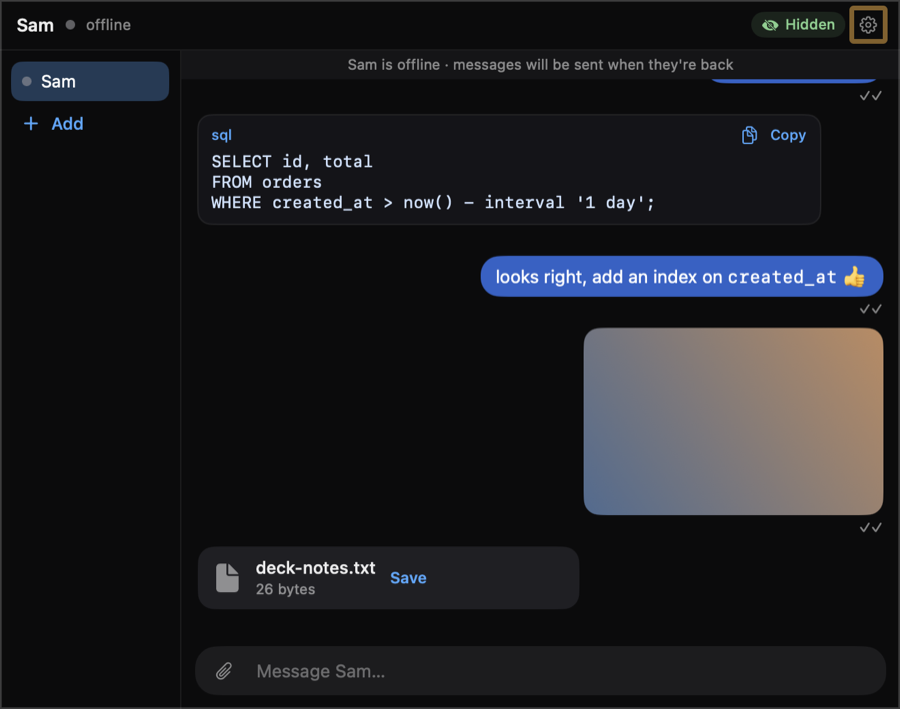
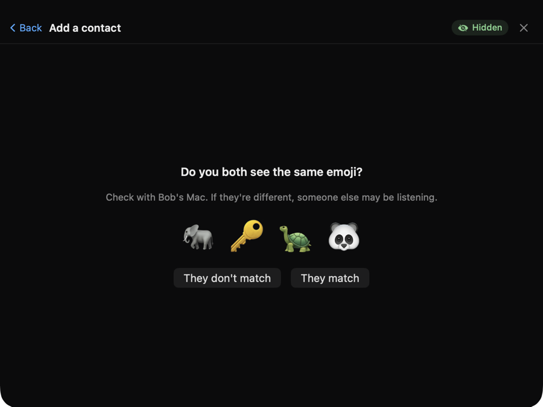

# Invisible Messenger

A private chat for Macs on the same Wi-Fi that **doesn't show up in screen sharing, screen recordings or screenshots**. You can keep talking to a colleague while you present in Zoom, Meet or Teams, record a demo, or share your whole screen.

- Lives **in the notch** (or in a small floating window) and drops down when you need it.
- **Pair once** with a short code; after that the Macs find each other automatically.
- **End-to-end encrypted**, directly between the two Macs. No server, no account, no internet.
- Text, **code blocks** with a copy button, **images** and **files** (up to 100 MB).
- History is kept **encrypted on disk**. Optional Touch ID or password lock.

<p>
  
  
</p>

## Requirements

- macOS 26 or later on every Mac that runs it.
- To build: Xcode 26 or later (for the Swift 6.2+ toolchain).

## Build and install

```bash
git clone https://github.com/asadiko/invisible-messenger.git
cd invisible-messenger
scripts/build-app.sh
cp -R "build/Invisible Messenger.app" /Applications/
open "/Applications/Invisible Messenger.app"
```

The script signs the app with your first "Apple Development" certificate if you have one, so macOS doesn't keep asking for Keychain access after rebuilds. Without one it signs ad hoc. Pick a different identity with `SIGN_IDENTITY="…" scripts/build-app.sh`.

On first launch macOS asks to let the app **find devices on your local network**. Click **Allow**. It can't reach the other Mac without this.

### On the second Mac

Copy `Invisible Messenger.app` over (AirDrop, a USB stick, or build it there too) and put it in Applications. The app isn't notarized, so the first time you open it macOS blocks it:

1. Try to open it once, then click **Done**.
2. Open **System Settings › Privacy & Security**, scroll down and click **Open Anyway** next to Invisible Messenger.
3. Allow local network access when asked.

## Using it

There is no Dock icon and no menu bar icon. That's on purpose, so nothing on a shared screen gives the app away.

- **Open / close:** press **⌥⌘M** (you can change it in Settings), or hover over the notch and click **Open**. Close with Esc, the **▲ close** tab, the shortcut, or by clicking anywhere else. The 📌 pin keeps it open while you click other apps.
- **Resize:** drag the left or right edge of the panel (it grows evenly around the notch) or the bottom edge. It starts three notches wide. **Settings › Reset** brings that back.
- **Add a contact:** click **＋ Add**. One Mac shows an 8-character code and the other types it in. Both Macs then show four emoji. If they match on both screens, click **They match**. From then on the two Macs reconnect by themselves whenever both are on the same network.
- **Send things:** type and press Return (Shift-Return for a new line). Wrap code in triple backticks (```` ```python ````) to get a code block with a Copy button. Paste or drop images and files, or use the 📎 button.
- **New messages:** the notch glows softly with a blue dot. There are no banners and no sounds.
- **Offline:** messages to a contact who is offline wait and are sent when they're back. ✓ means sent, ✓✓ means delivered.
- **Settings** (the gear icon):
  - notch or floating window
  - list or tabs layout
  - window opacity
  - shortcut
  - app lock (Touch ID or password) and auto-lock time
  - your name
  - rename, clear or remove contacts
  - save folder
  - open at login
  - delete all data
  - quit

## Security

- **Pairing:**
  - The code is never sent over the network.
  - It is stretched with PBKDF2 and mixed into an X25519 key exchange, so only someone who knows it can finish pairing.
  - A wrong guess can't be checked offline cheaply.
  - After three wrong tries the code is thrown away.
  - The four emoji come from both Macs' keys plus fresh random values. The Mac showing the code commits to its values before seeing the other Mac's, so a "man in the middle", even one who knows the code, can't make the emoji match. It shows up as different emoji.
- **Conversations:**
  - Every connection starts with a handshake that combines fresh ephemeral keys with the identity keys pinned during pairing. This gives mutual authentication and forward secrecy.
  - Messages are encrypted with ChaCha20-Poly1305.
  - Connections from unknown or changed keys are refused.
- **At rest:** messages and attachments are encrypted with a random key kept in your login Keychain.
- **App lock:** it keeps people at your Mac out of the chats. The encryption on disk protects the files either way.

## How hidden is it?

Every window the app creates is marked as excluded from screen capture, including the chat panel, the floating window, the image viewer and the file picker. You can check this on your own Mac:

```bash
scripts/capture-check.sh
```

It opens all of those windows in a throwaway copy of the app. It then captures the screen with ScreenCaptureKit (what Zoom, Meet, Teams and QuickTime use) and checks that none of them appear, while a normal test window does. Your terminal needs Screen Recording permission. On macOS 26.6 every window passed:

```
OK    control window (not hidden) is visible in captures (difference 98.3)
PASS  app window 660×542 at (570, 0) hidden (difference 0.02)
PASS  app window 880×448 at (430, 210) hidden (difference 0.05)
PASS  app window 321×244 at (710, 482) hidden (difference 0.22)
PASS  app window 340×480 at (1357, 65) hidden (difference 0.00)
All 4 windows are hidden from screen capture.
```

**What it can't hide.** Things drawn by macOS rather than by the app can still appear in a share:
- the **Touch ID prompt** (the app password unlocks inside the hidden panel instead)
- the first-launch **Local Network** and **Keychain** prompts
- the **Emoji & Symbols** picker
- input-method candidate windows
- menus and previews opened from inside the file picker
- the "Background Items Added" notice when you turn on **Open at login**

Very long pasted text is sent as a `Pasted text.txt` file. File names from the other Mac are cleaned, so **Save** always writes inside your save folder.

A camera pointed at your screen sees everything, of course. Before relying on it in an important meeting, do a quick test share with a friend.

## Development

```bash
swift test                       # core (crypto, protocol, storage, networking, pairing) and app model tests
scripts/build-app.sh --debug     # debug build
scripts/run-pair-demo.sh         # two separate copies ("alice" and "bob") to try pairing on one Mac
scripts/make-icon.sh             # redraw Resources/AppIcon.icns (designs: notch, eye, ghost, glass)
```

The app icon is drawn in code (`scripts/make-icon.swift`). The other designs are in [docs/images/icon-options.png](docs/images/icon-options.png); `scripts/make-icon.sh eye`, for example, switches to one of them.

`IM_PROFILE=<name>` gives a copy of the app its own data folder, Keychain items and preferences. The code is split in two:
- `Sources/MessengerCore`: everything testable without a UI.
- `Sources/InvisibleMessenger`: the AppKit/SwiftUI app.

The design is in `docs/specs/`.
